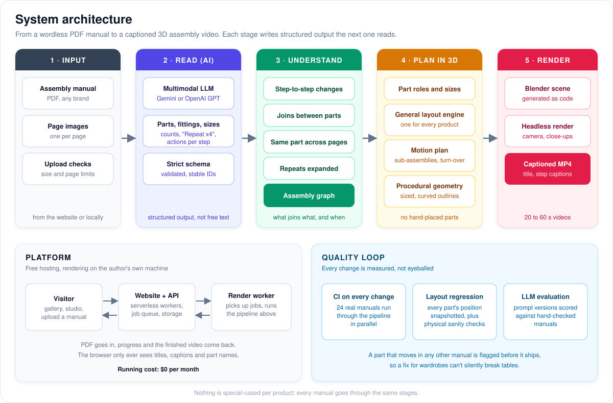

<div align="center">

# AI Assembly Video Generator

### Upload a flat-pack furniture manual. Get back an animated 3D video of it being built, step by step.

[](https://ai-assembly-video-generator.syed-ali-haider.workers.dev)
[](examples/README.md)
[](#quality-every-change-is-measured)


*Left: a page of the paper manual. Right: the video generated from it. Every step in the drawings becomes a captioned 3D animation.*

</div>

---

## Why I built this

When I moved to the UK, I quickly realised that many products I bought needed self-assembly: furniture, bicycles, shelving, children's toys, household appliances. They almost always arrived with an instruction manual made of diagrams and very little text.

The manuals were technically correct, but working out the diagrams often took longer than assembling the product itself. If I misunderstood one step, I had to undo the work and start again, wasting both time and effort.

Like most people, I searched YouTube for assembly videos. Sometimes they existed, but for many products they simply didn't. That led me to a simple question:

> **What if AI could understand any instruction manual and automatically generate an animated assembly video?**

This project is my answer. The long-term goal is to help people assemble products quickly and confidently by turning static manuals into clear, AI-generated visual guidance, starting with flat-pack furniture and growing to bicycles, gym equipment, toys and DIY kits.

## At a glance

| | |
|---|---|
| **The problem** | Flat-pack manuals have no words. Misreading one drawing means undoing the work. Most products have no assembly video. |
| **What I built** | An end-to-end AI system that reads a manual's drawings, works out how the product goes together, and renders a captioned 3D assembly video. No hand animation and no per-product setup. |
| **Scale** | Tested on **24 real manuals**: tables, chairs, beds, wardrobes, dressers, desks and sofas. The largest is **48 pages with 357 parts and fittings**, turned into a 55-second video. |
| **Live** | A public website with a gallery, a synced "studio" view and **live uploads**, running for **$0 a month**. |
| **Quality** | Every change runs all 24 manuals through the pipeline in CI, with layout regression snapshots, physical sanity checks and an LLM evaluation harness. |

## Architecture



The system never asks a model to "make a video". It breaks the problem into stages, each producing **structured, inspectable output** for the next:

1. **Read (AI).** A multimodal LLM (Google Gemini or OpenAI GPT) reads every page and returns parts, fittings, counts, sizes and actions in a strict schema. Each page is validated, and every object gets a stable ID.
2. **Understand.** The steps become an **assembly graph**: what joins what, and in which order. The same part is tracked across pages, and "Repeat x4" is expanded.
3. **Plan in 3D.** One **general layout engine** places every product as a frame of uprights, walls, beams, plates and blocks, working from the graph. It then plans the motion, including sub-assemblies built aside and pieces turned over at the end.
4. **Render.** A Blender scene is **generated as code** and rendered headlessly, then cut into an MP4 with step captions and close-ups.

<details>
<summary><b>All 15 stages in detail</b></summary>

1. **PDF page extraction.** Each page of the manual becomes an image.
2. **Vision reading.** A vision model reads every page and records the parts and fittings drawn, how many of each, the sizes where they are printed, and the action on that page (insert, attach, screw, turn over). Each page is checked against a strict schema, and every part, fitting and diagram gets a stable ID.
3. **Assembly delta detection.** Pages are compared one after another to find what was added at each step.
4. **Assembly action extraction.** The changes become actions: which part or fitting joins which, and how. Where a page shows only the screws, the joined parts are worked out from the evidence.
5. **Object identity resolution.** The same part is tracked across pages, so the "side panel" on page 3 and on page 12 is one object, and each action is pointed at the right instance.
6. **Action replication.** "Repeat x4", or one leg drawn when four get fitted, becomes the right number of actions across the matching parts, capped at what the manual shows.
7. **Universal Assembly Graph.** All parts, fittings and joins go into one graph of what connects to what, and in what order. It is built twice: once from the raw actions and again after identity resolution and replication.
8. **Motion planning.** Each part is given exactly one step at which it moves, plus the direction it comes from.
9. **Part shapes and roles.** Every part gets a role from its name (leg, rail, side panel, shelf, door, drawer front, slat, cushion, ...) and a size from the manual's measurements, or from sensible defaults for that role when none are printed. Curved parts keep the outline traced from the drawings.
10. **Scene layout engine.** One general layout places every product. Walls stand on the floor, rails stretch between the parts they join, shelves sit between side walls, doors and drawers fill the front opening, and brackets go into inside corners. The assembly graph decides where each part goes; name words like *left*, *front* or *top* only break ties.
11. **Sub-assembly staging.** Parts built separately, such as a drawer or a chaise base with its feet, are put together beside the main piece and then move into place as one unit. A piece built upside down is turned over at the end.
12. **Procedural proxy geometry.** Clean 3D shapes are made to the right size, including extruded outlines for bentwood frames and curved slats.
13. **Blender scene generation.** A Blender Python script is generated with the parts, materials, lighting, a camera that circles the piece and closes in on small steps, and a timeline that merges repeated moves.
14. **Headless rendering.** Blender renders the frames with no window open.
15. **Video.** The frames are joined into an MP4, with a caption for each step and the product's name at the top.


</details>

## Examples

Ten finished videos, each with its own page: the video, a frame from every step, the step list with the manual page each step comes from, and the parts list. **[Browse all examples →](examples/README.md)**

<table>
<tr>
<td align="center"><a href="examples/hemnes_dresser/README.md"><br><b>HEMNES 8-drawer dresser</b></a><br><sub>48 pages · 357 parts · 0:55</sub></td>
<td align="center"><a href="examples/brimnes_wardrobe/README.md"><br><b>BRIMNES wardrobe</b></a><br><sub>36 pages · 176 parts · 0:50</sub></td>
<td align="center"><a href="examples/poang_chair/README.md"><br><b>POÄNG bentwood armchair</b></a><br><sub>12 pages · 42 parts · 0:26</sub></td>
</tr>
<tr>
<td align="center"><a href="examples/kivik_chaise_longue/README.md"><br><b>KIVIK chaise longue</b></a><br><sub>16 pages · 40 parts · 0:26</sub></td>
<td align="center"><a href="examples/norden_table/README.md"><br><b>NORDEN extendable table</b></a><br><sub>no sizes printed · 128 parts · 0:43</sub></td>
<td align="center"><a href="examples/kaycie_bed/README.md"><br><b>Habitat Kaycie bed</b></a><br><sub>15 pages · 114 parts · 0:32</sub></td>
</tr>
</table>

The HEMNES dresser, from a 48-page manual to a 55-second video:


## Engineering highlights

- **Multimodal LLMs with structured output.** Google Gemini and OpenAI GPT models sit behind one interface, so the same evaluation set can compare them. The model fills a strict schema rather than writing free text. Every answer is validated, gets stable IDs and can be traced back to its page.
- **Graph reasoning over the whole manual.** Identity tracking, repeat expansion and joins inferred from screw-only pages turn scattered drawings into one consistent assembly graph.
- **A general spatial layout engine.** Beds, wardrobes, chairs, sofas and desks are all placed by the same rules, never one layout per product. New furniture types are supported by improving the general rules.
- **Procedural 3D and code generation.** Parts are modelled to size, curved parts follow their traced outlines, and the Blender scene, camera and timeline are generated as code.
- **Evaluation-driven development.**
  - Each of the 24 manuals has a snapshot of every part's final position.
  - Automated checks flag parts below the floor, panels passing through each other and parts floating away from what they're joined to.
  - An evaluation harness scores the LLM's reading of each manual against a hand-checked description, so prompt changes are compared on numbers, not impressions.
- **Production on a $0 budget.** A serverless website and job queue run on Cloudflare's free plan. A render worker on the author's machine picks up uploads, and visitors follow progress live.
- **Confidential by design.** The public site only ever sends titles, captions and part names. No model output, pipeline internals or logs leave the server.

## Quality: every change is measured

```
change to the layout rules
   └─► CI runs all 24 manuals through the pipeline (in parallel)
         ├─► every part's final position compared with its snapshot
         ├─► physical sanity checks (floor, overlaps, floating parts)
         └─► schema tests and generated-script compilation
   a part that moves in any other manual fails the build
```

A fix for wardrobes can't quietly break tables. When a change is intended, the snapshots are reviewed visually and updated on purpose.

## The website

| Studio: video, manual page and parts list in sync | Upload your own manual |
|---|---|
|  |  |

**[Open the live site →](https://ai-assembly-video-generator.syed-ali-haider.workers.dev)**
- **Watch an example.** As a video plays, the manual turns to the matching page and the parts list ticks itself off. Click any step to jump to it.
- **Upload your own.** Send a PDF of up to 10 pages and 2 MB. The video is made in a few minutes, with live progress, while the render machine is online.

## How the project grew

The first version was an experimental MVP on **Azure AI Foundry and Azure OpenAI GPT-4o Vision**, with a Streamlit front end. It proved that the whole chain worked, but the parts were generic boxes and complex manuals confused it. The current version keeps the staged design and rebuilds most of it.

| | First MVP | Now |
|---|---|---|
| Manual reading | Azure GPT-4o Vision | Multimodal LLM with a strict per-page schema, plus an evaluation harness |
| Layout | Exploded ring of parts | One general layout that builds the real frame for every product |
| Geometry | Generic proxy boxes | Parts sized from the manual, curved outlines traced from the drawings |
| Motion | One part at a time | Repeated moves merged, sub-assemblies moved as one unit, a final turn-over |
| Video | Plain render | Step captions with fitting counts, product title, close-ups on small steps |
| Interface | Local Streamlit app | Public website with gallery, synced studio and live uploads |
| Quality checks | Manual | CI on 24 manuals with layout regression and sanity checks |

<details>
<summary><b>What it can build</b></summary>

- **Tables and chairs:** legs, rails, corner brackets, tabletops, and seats and backs with slats.
- **Beds:** headboards, footboards, side rails, centre supports, slats and storage drawers.
- **Cabinets, dressers and wardrobes:** side panels, dividers, shelves, back panels and plinths; doors with hinges; drawers with their sides, backs, bottoms, runners and handles.
- **Upholstered furniture:** sofa sections, chaises, feet and cushions, with the hardware that joins them.
- **Curved parts:** bentwood frames and curved slats are drawn to their real outline, not as boxes.
- **Fittings:** screws, bolts, cam locks, dowels, plugs and washers, in the counts the manual gives.
- **What manuals do that computers find hard:**
  - "Repeat x4", or one leg drawn when four get fitted
  - pieces built separately and then joined (a drawer, a chaise base)
  - furniture built upside down and turned over at the end
  - manuals that print no sizes at all: sizes are estimated from the drawings

</details>

<details>
<summary><b>Inside a video</b></summary>

- **Title band:** the product's name across the top, with the furniture kept clear of it.
- **Captions:** one per step, e.g. *"Attach 2 x drawer side to small drawer front"*, with the fitting count from the manual.
- **Motion:** the parts for each step are highlighted and slide in. Small fittings are shown larger while they move, then shrink to their real size.
- **Camera:** circles the piece as it grows, closes in on small steps, and finishes at the front of the finished furniture.
- **Pacing:** consecutive steps that do the same thing (fit four legs, insert eight plugs) are merged into one smooth move.

</details>

<details>
<summary><b>Limits</b></summary>

- Uploads are up to **10 pages and 2 MB**. The examples show it working on manuals of up to 48 pages.
- Uploads are rendered on the author's own machine, so they're open only while it is online. The examples are always available.
- Parts are clean, simplified 3D shapes in the right size and place, not photo-realistic models.
- Manuals that are mostly text, or scanned at low quality, give weaker results than clear line drawings.

</details>

## Lessons learned

- **Most of the work is understanding, not rendering.** Drawing 3D boxes is easy. Knowing which box goes where, and when, is the hard part.
- **Structure beats one big prompt.** Small stages with structured outputs made errors visible and fixable.
- **Generalise, don't special-case.** Each new kind of furniture improved the one general layout instead of adding a layout for that product.
- **Measure before you improve.** Regression snapshots and an LLM evaluation set turned "looks better" into numbers.

## Roadmap

- **Understanding:** prompt iterations scored on the evaluation set; multi-view reasoning for dense pages.
- **Graphics:** CAD-aware parametric parts and more realistic materials.
- **Animation:** collision-aware motion and tool animations (an Allen key turning).
- **Experience:** voice narration, step-by-step playback controls and always-on uploads.
- **Products:** beyond furniture, to bicycles, gym equipment, toys and DIY kits.

## FAQ

**Does it work with any brand?** It is built for the wordless line-drawing style that IKEA, Habitat and most flat-pack brands use.

**Is anything set up by hand for each product?** No. A new manual goes through the same stages as every example here.

**Can I see the source code?** The source is private. This repository shows what the project does. For a technical walkthrough, get in touch.

## Tech stack

- **AI:** multimodal LLMs: Google Gemini and OpenAI GPT vision for reading manuals (the example manuals were read with Claude and reviewed) · structured outputs with schema validation · an LLM evaluation harness
- **3D:** Blender and generated Blender Python (bpy) scripts · procedural geometry · headless rendering · MoviePy
- **Platform:** Python 3.11 · Cloudflare Workers and Durable Objects · a render worker · HTML, CSS and JavaScript with no framework
- **Engineering:** GitHub Actions CI · layout regression snapshots · automated sanity checks

## Author

**Syed Ali Haider**, AI Engineer · [Portfolio](https://syedalihaider.pages.dev) · [LinkedIn](https://www.linkedin.com/in/syed-ali-haider1993) · [GitHub](https://github.com/alihaider1993)

---

<sub>Manuals shown belong to their makers and are used for demonstration only. © 2026 Syed Ali Haider. All rights reserved.</sub>
