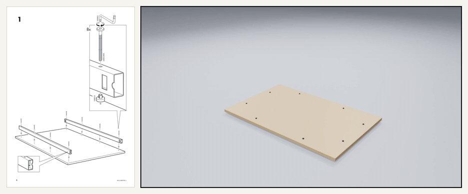
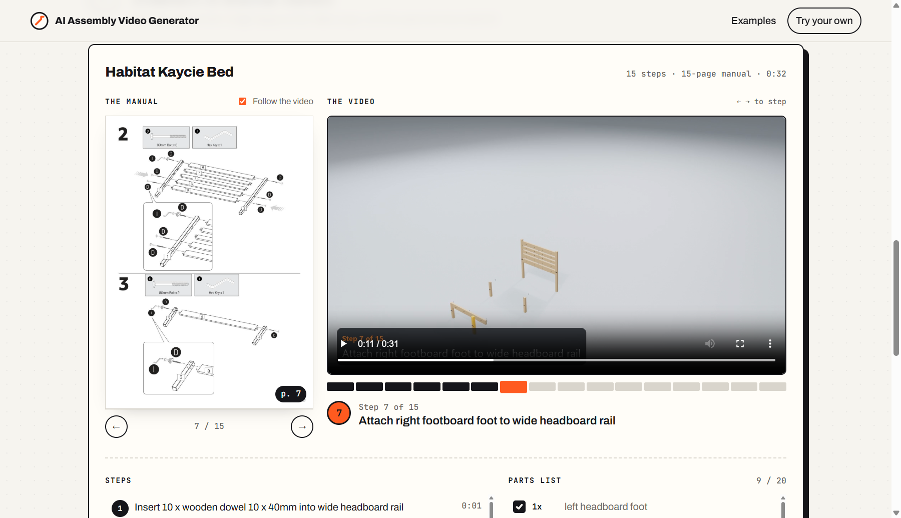
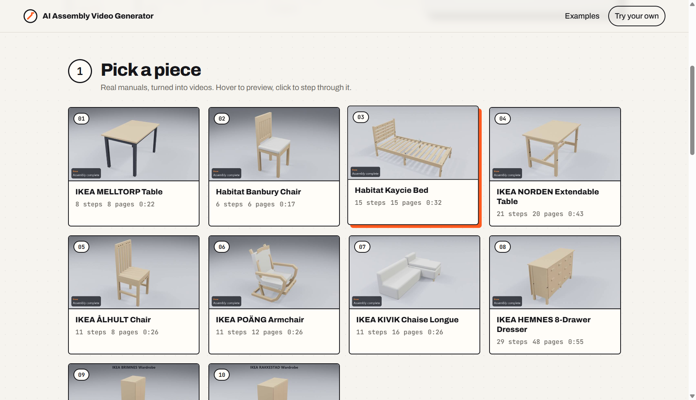
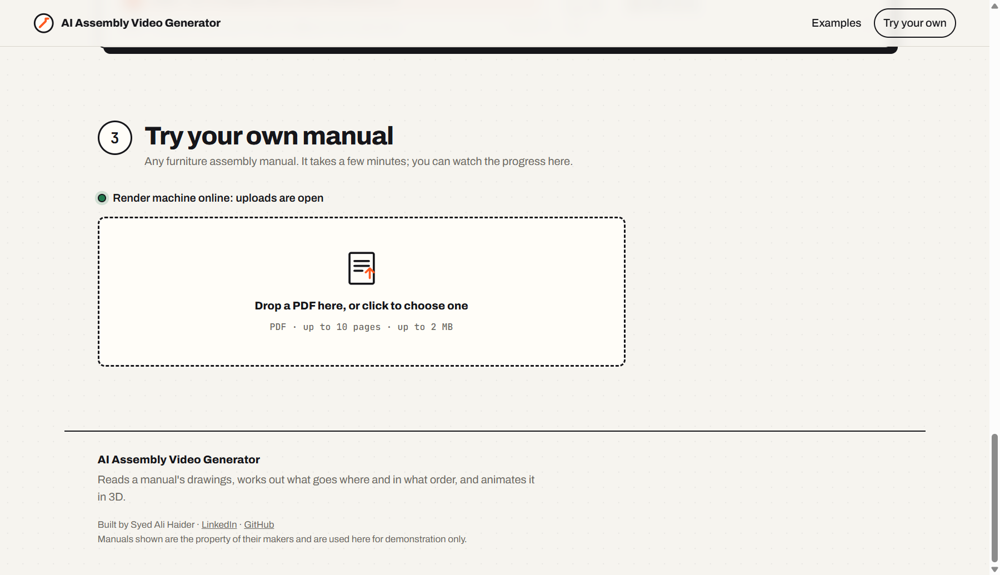

# AI Assembly Video Generator

**Upload a flat-pack furniture manual. Get back an animated 3D video of it being built, step by step.**

*Left: a page of the paper manual. Right: the video generated from it. Every step in the drawings becomes a captioned 3D animation.*

## Try it

**[ai-assembly-video-generator.syed-ali-haider.workers.dev](https://ai-assembly-video-generator.syed-ali-haider.workers.dev)**

- **Watch the examples:** ten real IKEA and Habitat manuals. As a video plays, the manual turns to the matching page and the parts list ticks itself off. Click any step to jump to it.
- **Upload your own manual:** a PDF of up to 10 pages and 2 MB. The video is made in a few minutes, with live progress, while the render machine is online.

## What it does

- Reads the manual's drawings: the parts, the fittings and how many of each, and the order they go together
- Works out where every part sits in the finished piece and how it moves into place
- Animates each step in 3D, with captions such as *"Insert 4 x hex head bolt into leg"*
- Renders a finished MP4 with the product's name and every step captioned

## Examples on the site

| Product | Manual pages | Steps | Parts and fittings | Video |
|---|---:|---:|---:|---:|
| IKEA MELLTORP Table | 8 | 8 | 41 | 0:22 |
| Habitat Banbury Chair | 6 | 6 | 35 | 0:17 |
| Habitat Kaycie Bed | 15 | 15 | 114 | 0:32 |
| IKEA NORDEN Extendable Table | 20 | 21 | 128 | 0:43 |
| IKEA ÅLHULT Chair | 8 | 11 | 36 | 0:26 |
| IKEA POÄNG Armchair | 12 | 11 | 42 | 0:26 |
| IKEA KIVIK Chaise Longue | 16 | 11 | 40 | 0:26 |
| IKEA HEMNES 8-Drawer Dresser | 48 | 29 | 357 | 0:55 |
| IKEA BRIMNES Wardrobe | 36 | 26 | 176 | 0:50 |
| IKEA RAKKESTAD Wardrobe | 32 | 24 | 154 | 0:46 |

## Tech stack

- **Python**
- **Blender** for 3D animation and rendering
- **Google Gemini** (vision) for reading the manuals' drawings
- **Cloudflare Workers and Durable Objects** for the website and uploads
- **HTML, CSS and JavaScript** for the site, with no framework

## Author

**Syed Ali Haider**: [LinkedIn](https://www.linkedin.com/in/syed-ali-haider1993) · [GitHub](https://github.com/alihaider1993)

---

Manuals shown belong to their makers and are used for demonstration only. © 2026 Syed Ali Haider. All rights reserved.
