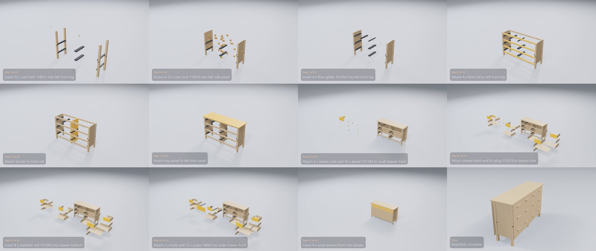

# AI Assembly Video Generator

**Upload a flat-pack furniture manual. Get back an animated 3D video of it being built, step by step.**

*Left: a page of the paper manual. Right: the video generated from it. Every step in the drawings becomes a captioned 3D animation.*

## Contents

- [Why](#why)
- [Try it](#try-it)
- [What it does](#what-it-does)
- [Examples](#examples)
- [What it can build](#what-it-can-build)
- [Inside a video](#inside-a-video)
- [The website](#the-website)
- [Limits](#limits)
- [FAQ](#faq)
- [Tech stack](#tech-stack)
- [Author](#author)

## Why

Flat-pack manuals have no words. A few line drawings carry every step, and it is easy to misread which panel faces which way, which of five similar screws goes where, or what "x4" refers to. A short video that shows each part moving into place, with the step written underneath, is much easier to follow. This project makes that video from the manual itself, for any product, with no hand animation.

## Try it

**[ai-assembly-video-generator.syed-ali-haider.workers.dev](https://ai-assembly-video-generator.syed-ali-haider.workers.dev)**

- **Watch the examples:** ten real IKEA and Habitat manuals. As a video plays, the manual turns to the matching page and the parts list ticks itself off. Click any step to jump to it.
- **Upload your own manual:** a PDF of up to 10 pages and 2 MB. The video is made in a few minutes, with live progress, while the render machine is online.

## What it does

1. **Reads the manual.** It goes through the drawings page by page: the parts and fittings, how many of each, the sizes where the manual prints them, and what happens on each page.
2. **Works out the finished piece.** It decides where every part sits in the assembled furniture, which parts join which, and the order they go together, including steps that say "repeat x4" or show only one of several identical parts.
3. **Plans the motion.** Each part slides in from a clear direction at its step. Screws and bolts travel into their holes, and pieces built separately (a drawer, a chaise base with its feet) move into place as one unit.
4. **Renders it in 3D.** Every part is modelled to size and shape, the camera circles the piece, and the steps are captioned, e.g. *"Insert 4 x hex head bolt into leg"*.
5. **Delivers an MP4** with the product's name at the top and every step captioned, ready to watch or download.

## Examples

Every example has its own page with the video, a frame from each step, the full step list with the manual page each step comes from, and the parts list. **[Browse all examples →](examples/README.md)**

| Product | Type | Manual pages | Steps | Parts and fittings | Video |
|---|---|---:|---:|---:|---:|
| [IKEA MELLTORP Table](examples/melltorp_table/README.md) | Table | 8 | 8 | 41 | [0:22](examples/melltorp_table/video.mp4) |
| [Habitat Banbury Chair](examples/banbury_chair/README.md) | Chair | 6 | 6 | 35 | [0:17](examples/banbury_chair/video.mp4) |
| [Habitat Kaycie Bed](examples/kaycie_bed/README.md) | Bed | 15 | 15 | 114 | [0:32](examples/kaycie_bed/video.mp4) |
| [IKEA NORDEN Extendable Table](examples/norden_table/README.md) | Table, no sizes printed | 20 | 21 | 128 | [0:43](examples/norden_table/video.mp4) |
| [IKEA ÅLHULT Chair](examples/alhult_chair/README.md) | Chair | 8 | 11 | 36 | [0:26](examples/alhult_chair/video.mp4) |
| [IKEA POÄNG Armchair](examples/poang_chair/README.md) | Bentwood armchair | 12 | 11 | 42 | [0:26](examples/poang_chair/video.mp4) |
| [IKEA KIVIK Chaise Longue](examples/kivik_chaise_longue/README.md) | Upholstered sofa | 16 | 11 | 40 | [0:26](examples/kivik_chaise_longue/video.mp4) |
| [IKEA HEMNES 8-Drawer Dresser](examples/hemnes_dresser/README.md) | Chest of drawers | 48 | 29 | 357 | [0:55](examples/hemnes_dresser/video.mp4) |
| [IKEA BRIMNES Wardrobe](examples/brimnes_wardrobe/README.md) | Wardrobe | 36 | 26 | 176 | [0:50](examples/brimnes_wardrobe/video.mp4) |
| [IKEA RAKKESTAD Wardrobe](examples/rakkestad_wardrobe/README.md) | Wardrobe | 32 | 24 | 154 | [0:46](examples/rakkestad_wardrobe/video.mp4) |

The largest, the HEMNES dresser, goes from a 48-page manual with 357 parts and fittings to a 55-second video:

## What it can build

The same system handles every product above. Nothing is set up by hand for a particular manual.

- **Tables and chairs:** legs, rails, corner brackets, tabletops, and seats and backs with slats.
- **Beds:** headboards, footboards, side rails, centre supports and slats.
- **Cabinets, dressers and wardrobes:** side panels, dividers, shelves, back panels and plinths; doors with hinges; drawers with their sides, backs, bottoms, runners and handles.
- **Upholstered furniture:** sofa sections, chaises, feet and cushions, with the hardware that joins them.
- **Curved parts:** bentwood frames and curved slats are drawn to their real outline, not as boxes.
- **Fittings:** screws, bolts, cam locks, dowels, plugs and washers, in the counts the manual gives.
- **Things manuals do that a computer finds hard:**
  - "Repeat x4", or one leg drawn when four get fitted
  - pieces built separately and then joined (a drawer, a chaise base)
  - furniture built upside down and turned over at the end
  - manuals that print no sizes at all (NORDEN): sizes are estimated from the drawings

## Inside a video

- **Title band:** the product's name across the top, with the furniture kept clear of it.
- **Captions:** one per step, e.g. *"Attach 2 x drawer side to small drawer front"*, with the step number and the fitting count from the manual.
- **Motion:** the parts for each step are highlighted and slide in. Small fittings are shown larger while they move so they can be seen, then shrink to their real size.
- **Pacing:** consecutive steps that do the same thing (fit four legs, insert eight plugs) are merged into one smooth move.
- **Camera:** circles the piece as it grows and finishes looking at the front of the finished furniture.
- **Finish:** a turn-over when the piece was built upside down, then a last look at the assembled product.

## The website

- **Gallery:** every example with its poster, page count and length.
- **Studio:** the video, the manual and the parts list side by side and kept in sync. The manual turns to the page for the current step, the parts used so far are ticked off, and clicking a step jumps the video there.
- **Upload:** drop in a PDF manual and follow its progress in plain language ("Reading the manual", "Animating", ...). The finished video plays in the same studio view and can be downloaded.

## Limits

- Uploads are up to **10 pages and 2 MB**. The examples show it working on manuals of up to 48 pages.
- Uploads are rendered on the author's own machine, so they are open only while it is online. The examples are always available.
- Parts are shown as clean, simplified 3D shapes in the right size and place, not photo-realistic models.
- Manuals that are mostly text, or scanned at low quality, give weaker results than clear line drawings.

## FAQ

**Does it work with any brand?**
It is built for the wordless line-drawing style that IKEA, Habitat and most flat-pack brands use. The examples include both brands.

**How long does a video take?**
A few minutes for a typical upload. Most of that is 3D rendering.

**Is anything set up by hand for each product?**
No. A new manual goes through the same steps as every example here.

**Can I get the source code?**
The source is private. This repository shows what the project does: the demo, the examples and the website. For a walkthrough, get in touch below.

## Tech stack

- **Python**
- **Blender** for 3D modelling, animation and rendering
- **Google Gemini** (vision) for reading the manuals' drawings
- **MoviePy** for the final video and its captions
- **Cloudflare Workers and Durable Objects** for the website and uploads
- **HTML, CSS and JavaScript** for the site, with no framework

## Author

**Syed Ali Haider**: [LinkedIn](https://www.linkedin.com/in/syed-ali-haider1993) · [GitHub](https://github.com/alihaider1993)

---

Manuals shown belong to their makers and are used for demonstration only. © 2026 Syed Ali Haider. All rights reserved.
