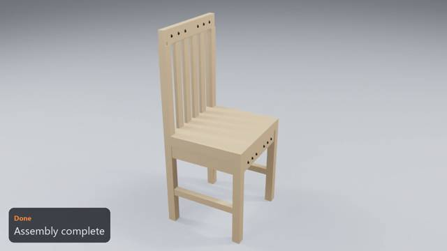
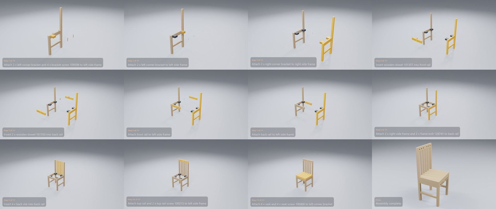

# IKEA ÅLHULT Chair

**[Watch the video](video.mp4)** (0:26) · 8 manual pages · 11 steps · 36 parts and fittings

## The build, step by step

| Time | Step | What happens | Manual page |
|---|---|---|---|
| 0:01 | Step 1 of 11 | Attach 2 x left corner bracket and 4 x bracket screw 109598 to left side frame | 4 |
| 0:03 | Step 2 of 11 | Attach 2 x left corner bracket to left side frame | 4 |
| 0:04 | Step 3 of 11 | Attach 2 x right corner bracket to right side frame | 4 |
| 0:06 | Step 4 of 11 | Insert wooden dowel 101357 into front rail | 4 |
| 0:07 | Step 5 of 11 | Insert 2 x wooden dowel 101350 into back rail | 4 |
| 0:09 | Step 6 of 11 | Attach front rail to left side frame | 5 |
| 0:10 | Step 7 of 11 | Attach back rail to left side frame | 5 |
| 0:12 | Step 8 of 11 | Attach right side frame and 2 x frame bolt 128745 to back rail | 5 |
| 0:14 | Step 9 of 11 | Insert 4 x back slat into back rail | 6 |
| 0:16 | Step 10 of 11 | Attach top rail and 2 x top rail screw 100215 to left side frame | 7 |
| 0:17 | Step 11 of 11 | Attach seat and 4 x seat screw 100400 to left corner bracket | 8 |
| 0:20 | Done | Assembly complete | – |

## Parts

| Part | Qty |
|---|---:|
| left corner bracket | 2 |
| right corner bracket | 2 |
| left side frame | 1 |
| right side frame | 1 |
| front rail | 1 |
| back rail | 1 |
| back slat | 4 |
| top rail | 1 |
| seat | 1 |

## Fittings

| Fitting | Qty |
|---|---:|
| frame bolt 128745 | 4 |
| top rail screw 100215 | 2 |
| bracket screw 109598 | 4 |
| seat screw 100400 | 4 |
| wooden dowel 101357 | 2 |
| wooden dowel 101350 | 6 |

[← All examples](../README.md)
