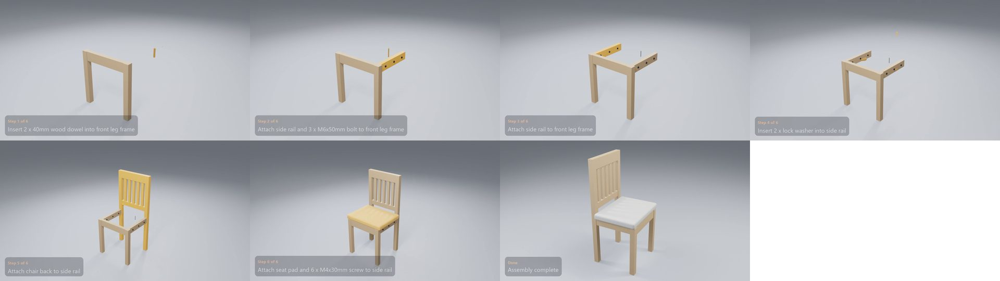

# Habitat Banbury Chair

**[Watch the video](video.mp4)** (0:17) · 6 manual pages · 6 steps · 35 parts and fittings

## The build, step by step

| Time | Step | What happens | Manual page |
|---|---|---|---|
| 0:01 | Step 1 of 6 | Insert 2 x 40mm wood dowel into front leg frame | 4 |
| 0:02 | Step 2 of 6 | Attach side rail and 3 x M6x50mm bolt to front leg frame | 4 |
| 0:04 | Step 3 of 6 | Attach side rail to front leg frame | 4 |
| 0:06 | Step 4 of 6 | Insert 2 x lock washer into side rail | 4 |
| 0:07 | Step 5 of 6 | Attach chair back to side rail | 5 |
| 0:09 | Step 6 of 6 | Attach seat pad and 6 x M4x30mm screw to side rail | 5 |
| 0:11 | Done | Assembly complete | – |

## Parts

| Part | Qty |
|---|---:|
| side rail | 2 |
| front leg frame | 1 |
| seat pad | 1 |
| chair back | 1 |

## Fittings

| Fitting | Qty |
|---|---:|
| 40mm wood dowel | 6 |
| M6x50mm bolt | 6 |
| lock washer | 6 |
| flat washer | 6 |
| M4x30mm screw | 6 |

[← All examples](../README.md)
