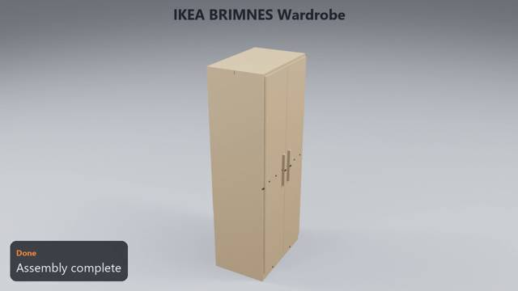
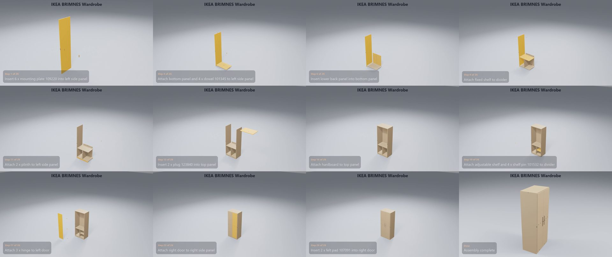

# IKEA BRIMNES Wardrobe

**[Watch the video](video.mp4)** (0:50) · 36 manual pages · 26 steps · 176 parts and fittings

## The build, step by step

| Time | Step | What happens | Manual page |
|---|---|---|---|
| 0:01 | Step 1 of 26 | Insert 6 x mounting plate 109220 into left side panel | 10 |
| 0:02 | Step 2 of 26 | Insert 10 x cam bolt 118331 into left side panel | 10 |
| 0:03 | Step 3 of 26 | Attach bottom panel and 4 x dowel 101345 to left side panel | 11 |
| 0:05 | Step 4 of 26 | Screw in 2 x cam lock 119252 into bottom panel | 11 |
| 0:07 | Step 5 of 26 | Insert 2 x connector pin 106940 into lower back panel | 12 |
| 0:08 | Step 6 of 26 | Insert lower back panel into bottom panel | 13 |
| 0:10 | Step 7 of 26 | Attach divider to bottom panel | 14 |
| 0:11 | Step 8 of 26 | Screw in 2 x screw 100214 into divider | 14 |
| 0:13 | Step 9 of 26 | Attach fixed shelf to divider | 15 |
| 0:14 | Step 10 of 26 | Attach left side panel to fixed shelf | 15 |
| 0:16 | Step 11 of 26 | Attach 2 x plinth to left side panel | 16 |
| 0:18 | Step 12 of 26 | Attach right side panel to bottom panel | 17 |
| 0:20 | Step 13 of 26 | Insert 2 x plug 123840 into top panel | 18 |
| 0:21 | Step 14 of 26 | Attach top panel to left side panel | 18 |
| 0:23 | Step 15 of 26 | Attach hardboard and 2 x nail 101206 to top panel | 20 |
| 0:25 | Step 16 of 26 | Attach hardboard to top panel | 20 |
| 0:26 | Step 17 of 26 | Insert 2 x rail holder 157306 into left side panel | 29 |
| 0:28 | Step 18 of 26 | Attach clothes rail to left side panel | 29 |
| 0:29 | Step 19 of 26 | Attach adjustable shelf and 4 x shelf pin 101532 to divider | 29 |
| 0:31 | Step 20 of 26 | Attach 3 x hinge and 6 x screw 105248 to left door | 30 |
| 0:33 | Step 21 of 26 | Attach 3 x hinge to left door | 30 |
| 0:35 | Step 22 of 26 | Attach left door to left side panel | 31 |
| 0:36 | Step 23 of 26 | Attach right door to right side panel | 31 |
| 0:38 | Step 24 of 26 | Attach handle and 2 x screw 109567 to left door | 32 |
| 0:40 | Step 25 of 26 | Attach handle to left door | 32 |
| 0:42 | Step 26 of 26 | Insert 2 x felt pad 107091 into right door | 33 |
| 0:44 | Done | Assembly complete | – |

## Parts

| Part | Qty |
|---|---:|
| clothes rail | 1 |
| hinge | 6 |
| handle | 2 |
| left side panel | 1 |
| right side panel | 1 |
| bottom panel | 1 |
| lower back panel | 1 |
| divider | 1 |
| fixed shelf | 1 |
| plinth | 2 |
| top panel | 1 |
| hardboard | 2 |
| adjustable shelf | 1 |
| left door | 1 |
| right door | 1 |

## Fittings

| Fitting | Qty |
|---|---:|
| connector pin 106940 | 2 |
| screw 100214 | 2 |
| cam lock 119252 | 20 |
| screw 109567 | 4 |
| dowel 101345 | 27 |
| cam bolt 118331 | 16 |
| nail 101206 | 40 |
| plug 123840 | 2 |
| nail guide 105494 | 1 |
| rail holder 157306 | 2 |
| mounting plate 109220 | 6 |
| shelf pin 101532 | 4 |
| felt pad 107091 | 1 |
| screw 105248 | 26 |

[← All examples](../README.md)
