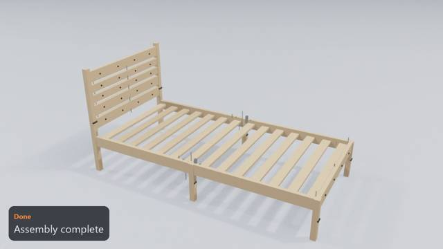
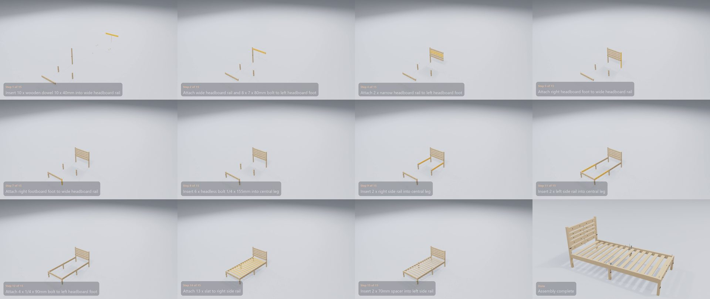

# Habitat Kaycie Bed

**[Watch the video](video.mp4)** (0:32) · 15 manual pages · 15 steps · 114 parts and fittings

## The build, step by step

| Time | Step | What happens | Manual page |
|---|---|---|---|
| 0:01 | Step 1 of 15 | Insert 10 x wooden dowel 10 x 40mm into wide headboard rail | 6 |
| 0:02 | Step 2 of 15 | Attach wide headboard rail and 8 x 7 x 80mm bolt to left headboard foot | 7 |
| 0:04 | Step 3 of 15 | Attach 2 x wide headboard rail to left headboard foot | 7 |
| 0:06 | Step 4 of 15 | Attach 2 x narrow headboard rail to left headboard foot | 7 |
| 0:07 | Step 5 of 15 | Attach right headboard foot to wide headboard rail | 7 |
| 0:09 | Step 6 of 15 | Attach left footboard foot to wide headboard rail | 7 |
| 0:11 | Step 7 of 15 | Attach right footboard foot to wide headboard rail | 7 |
| 0:13 | Step 8 of 15 | Insert 6 x headless bolt 1/4 x 155mm into central leg | 8 |
| 0:14 | Step 9 of 15 | Insert 2 x right side rail into central leg | 8 |
| 0:16 | Step 10 of 15 | Screw in 4 x nut into right side rail | 9 |
| 0:17 | Step 11 of 15 | Insert 2 x left side rail into central leg | 10 |
| 0:19 | Step 12 of 15 | Attach 4 x 1/4 x 90mm bolt to left headboard foot | 11 |
| 0:20 | Step 13 of 15 | Attach slat with stamp and 4 x 4 x 35mm screw to left side rail | 13 |
| 0:22 | Step 14 of 15 | Attach 13 x slat to right side rail | 13 |
| 0:24 | Step 15 of 15 | Insert 2 x 70mm spacer into left side rail | 14 |
| 0:26 | Done | Assembly complete | – |

## Parts

| Part | Qty |
|---|---:|
| left headboard foot | 1 |
| right headboard foot | 1 |
| left footboard foot | 1 |
| right footboard foot | 1 |
| central leg | 2 |
| wide headboard rail | 4 |
| narrow headboard rail | 2 |
| slat with stamp | 1 |
| slat | 13 |
| right side rail | 2 |
| left side rail | 2 |

## Fittings

| Fitting | Qty |
|---|---:|
| wooden dowel 10 x 40mm | 28 |
| 4 x 35mm screw | 28 |
| headless bolt 1/4 x 155mm | 2 |
| 7 x 80mm bolt | 8 |
| 70mm spacer | 2 |
| nut | 4 |
| curved washer | 4 |
| 1/4 x 90mm bolt | 4 |
| 1/4 half moon nut | 4 |

[← All examples](../README.md)
