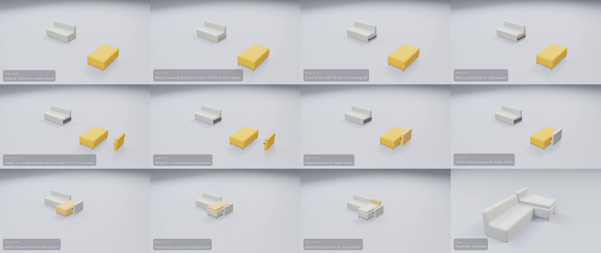

# IKEA KIVIK Chaise Longue

**[Watch the video](video.mp4)** (0:26) · 16 manual pages · 11 steps · 40 parts and fittings

## The build, step by step

| Time | Step | What happens | Manual page |
|---|---|---|---|
| 0:01 | Step 1 of 11 | Insert 4 x foot into chaise frame | 5 |
| 0:03 | Step 2 of 11 | Attach connecting rail and screw 121365 to sofa section | 7 |
| 0:04 | Step 3 of 11 | Screw in nut 100712 into connecting rail | 7 |
| 0:06 | Step 4 of 11 | Attach joining rail to sofa section | 8 |
| 0:07 | Step 5 of 11 | Attach 2 x corner bracket and 4 x screw 111374 to armrest | 9 |
| 0:09 | Step 6 of 11 | Attach 2 x corner bracket to armrest | 9 |
| 0:11 | Step 7 of 11 | Attach armrest to chaise frame | 9 |
| 0:13 | Step 8 of 11 | Attach clamp bracket to chaise frame | 10 |
| 0:14 | Step 9 of 11 | Attach chaise frame to sofa section | 13 |
| 0:16 | Step 10 of 11 | Attach seat cushion to chaise frame | 14 |
| 0:18 | Step 11 of 11 | Attach back cushion to chaise frame | 14 |
| 0:20 | Done | Assembly complete | – |

## Parts

| Part | Qty |
|---|---:|
| foot | 4 |
| corner bracket | 2 |
| connecting rail | 1 |
| joining rail | 1 |
| clamp bracket | 1 |
| chaise frame | 1 |
| sofa section | 1 |
| armrest | 1 |
| seat cushion | 1 |
| back cushion | 1 |

## Fittings

| Fitting | Qty |
|---|---:|
| nut 100712 | 5 |
| washer 100854 | 5 |
| toothed washer 100851 | 4 |
| screw 111374 | 4 |
| screw 121365 | 4 |
| bolt 100471 | 4 |

[← All examples](../README.md)
