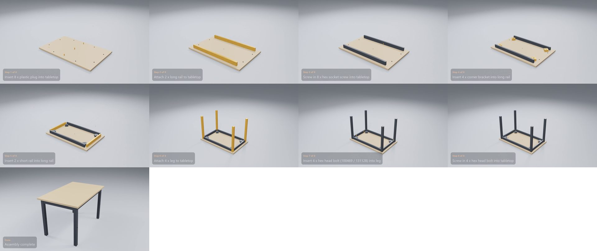

# IKEA MELLTORP Table

**[Watch the video](video.mp4)** (0:22) · 8 manual pages · 8 steps · 41 parts and fittings

## The build, step by step

| Time | Step | What happens | Manual page |
|---|---|---|---|
| 0:01 | Step 1 of 8 | Insert 8 x plastic plug into tabletop | 4 |
| 0:02 | Step 2 of 8 | Attach 2 x long rail to tabletop | 4 |
| 0:04 | Step 3 of 8 | Screw in 8 x hex socket screw into tabletop | 4 |
| 0:05 | Step 4 of 8 | Insert 4 x corner bracket into long rail | 5 |
| 0:07 | Step 5 of 8 | Insert 2 x short rail into long rail | 5 |
| 0:09 | Step 6 of 8 | Attach 4 x leg to tabletop | 6 |
| 0:10 | Step 7 of 8 | Insert 4 x hex head bolt (100469 / 131128) into leg | 6 |
| 0:12 | Step 8 of 8 | Screw in 4 x hex head bolt into tabletop | 7 |
| 0:13 | Finish | Turn the assembly over | – |
| 0:16 | Done | Assembly complete | – |

## Parts

| Part | Qty |
|---|---:|
| corner bracket | 4 |
| tabletop | 1 |
| long rail | 2 |
| short rail | 2 |
| leg | 4 |

## Fittings

| Fitting | Qty |
|---|---:|
| hex socket screw | 8 |
| hex head bolt (100469 / 131128) | 4 |
| spring washer | 4 |
| plastic plug | 8 |
| hex head bolt | 4 |

[← All examples](../README.md)
