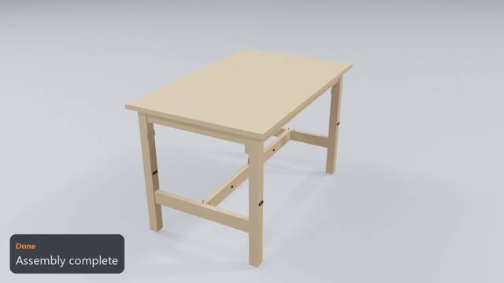
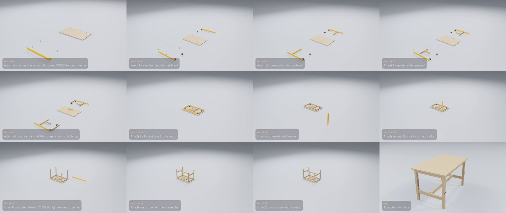

# IKEA NORDEN Extendable Table

**[Watch the video](video.mp4)** (0:43) · 20 manual pages · 21 steps · 128 parts and fittings

## The build, step by step

| Time | Step | What happens | Manual page |
|---|---|---|---|
| 0:01 | Step 1 of 21 | Attach 4 x corner bracket and 6 x screw 100325 to long side rail | 4 |
| 0:03 | Step 2 of 21 | Attach 4 x corner bracket to long side rail | 4 |
| 0:04 | Step 3 of 21 | Insert 4 x cam bolt into long side rail | 4 |
| 0:06 | Step 4 of 21 | Insert 4 x wooden dowel 101350 into cross rail | 5 |
| 0:07 | Step 5 of 21 | Attach 2 x cross rail to long side rail | 5 |
| 0:09 | Step 6 of 21 | Screw in 4 x cam lock into cross rail | 5 |
| 0:10 | Step 7 of 21 | Attach 2 x guide rail to cross rail | 6 |
| 0:12 | Step 8 of 21 | Attach 2 x end rail to long side rail | 6 |
| 0:14 | Step 9 of 21 | Attach slide runner rail and 16 x runner screw to tabletop | 7 |
| 0:15 | Step 10 of 21 | Attach 3 x slide runner rail to tabletop | 7 |
| 0:17 | Step 11 of 21 | Attach 2 x long side rail to tabletop | 8 |
| 0:19 | Step 12 of 21 | Insert 4 x cross dowel into leg | 9 |
| 0:20 | Step 13 of 21 | Insert 4 x threaded rod into leg | 9 |
| 0:21 | Step 14 of 21 | Insert metal angle plate into tabletop | 10 |
| 0:23 | Step 15 of 21 | Attach leg and 8 x nut to corner bracket | 10 |
| 0:25 | Step 16 of 21 | Attach 3 x leg to corner bracket | 10 |
| 0:26 | Step 17 of 21 | Insert 6 x wooden dowel 101353 (long) into long stretcher | 11 |
| 0:28 | Step 18 of 21 | Attach 2 x end stretcher to leg | 12 |
| 0:29 | Step 19 of 21 | Attach long stretcher to end stretcher | 13 |
| 0:31 | Step 20 of 21 | Insert 4 x floor glide into leg | 16 |
| 0:32 | Step 21 of 21 | Insert 2 x stop screw into tabletop | 17 |
| 0:34 | Finish | Turn the assembly over | – |
| 0:37 | Done | Assembly complete | – |

## Parts

| Part | Qty |
|---|---:|
| corner bracket | 4 |
| long side rail | 2 |
| end rail | 2 |
| cross rail | 2 |
| guide rail | 2 |
| tabletop | 1 |
| slide runner rail | 4 |
| leg | 4 |
| end stretcher | 2 |
| long stretcher | 1 |

## Fittings

| Fitting | Qty |
|---|---:|
| wooden dowel 101353 (long) | 6 |
| wooden dowel 101350 | 12 |
| cam bolt | 10 |
| cam lock | 10 |
| runner screw | 16 |
| stop screw | 2 |
| screw 100325 | 24 |
| cross dowel | 4 |
| threaded rod | 4 |
| nut | 4 |
| washer | 4 |
| metal angle plate | 4 |
| floor glide | 4 |

[← All examples](../README.md)
