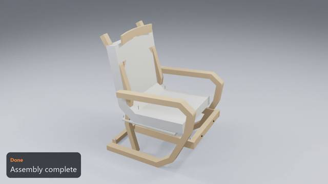
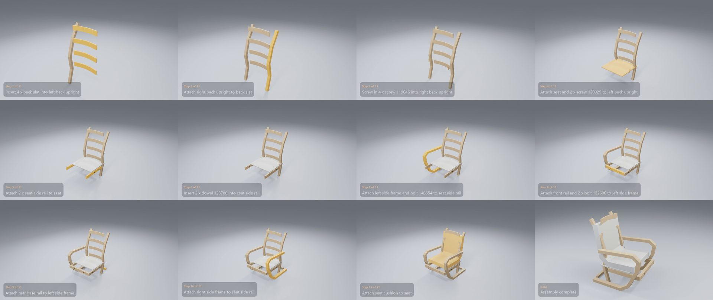

# IKEA POÄNG Armchair

**[Watch the video](video.mp4)** (0:26) · 12 manual pages · 11 steps · 42 parts and fittings

## The build, step by step

| Time | Step | What happens | Manual page |
|---|---|---|---|
| 0:01 | Step 1 of 11 | Insert 4 x back slat into left back upright | 4 |
| 0:03 | Step 2 of 11 | Attach right back upright to back slat | 4 |
| 0:04 | Step 3 of 11 | Screw in 4 x screw 119046 into right back upright | 5 |
| 0:06 | Step 4 of 11 | Attach seat and 2 x screw 120925 to left back upright | 6 |
| 0:07 | Step 5 of 11 | Attach 2 x seat side rail to seat | 7 |
| 0:09 | Step 6 of 11 | Insert 2 x dowel 123786 into seat side rail | 8 |
| 0:10 | Step 7 of 11 | Attach left side frame and bolt 146654 to seat side rail | 8 |
| 0:12 | Step 8 of 11 | Attach front rail and 2 x bolt 122606 to left side frame | 9 |
| 0:14 | Step 9 of 11 | Attach rear base rail to left side frame | 9 |
| 0:16 | Step 10 of 11 | Attach right side frame to seat side rail | 10 |
| 0:17 | Step 11 of 11 | Attach seat cushion to seat | 12 |
| 0:20 | Done | Assembly complete | – |

## Parts

| Part | Qty |
|---|---:|
| back slat | 4 |
| left back upright | 1 |
| right back upright | 1 |
| seat | 1 |
| seat side rail | 2 |
| left side frame | 1 |
| front rail | 1 |
| rear base rail | 1 |
| right side frame | 1 |
| seat cushion | 1 |

## Fittings

| Fitting | Qty |
|---|---:|
| bolt 122606 | 4 |
| bolt 146654 | 2 |
| dowel 123786 | 2 |
| screw 119046 | 8 |
| screw 120925 | 6 |
| barrel nut 100514 | 4 |
| washer 102319 | 2 |

[← All examples](../README.md)
