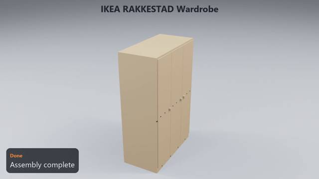
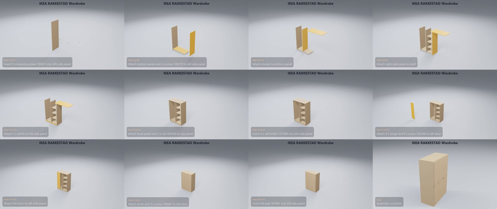

# IKEA RAKKESTAD Wardrobe

**[Watch the video](video.mp4)** (0:46) · 32 manual pages · 24 steps · 154 parts and fittings

## The build, step by step

| Time | Step | What happens | Manual page |
|---|---|---|---|
| 0:01 | Step 1 of 24 | Insert 9 x mounting plate 109221 into left side panel | 7 |
| 0:02 | Step 2 of 24 | Insert 4 x dowel 101345 into divider | 8 |
| 0:03 | Step 3 of 24 | Attach bottom panel and 2 x screw 100219 to left side panel | 9 |
| 0:05 | Step 4 of 24 | Insert 4 x plug 109837 into top panel | 10 |
| 0:07 | Step 5 of 24 | Insert angle bracket 103717 into top panel | 10 |
| 0:08 | Step 6 of 24 | Attach divider to bottom panel | 11 |
| 0:10 | Step 7 of 24 | Attach 3 x shelf to divider | 12 |
| 0:11 | Step 8 of 24 | Attach right side panel to shelf | 13 |
| 0:13 | Step 9 of 24 | Insert 4 x spacer 158568 into plinth | 14 |
| 0:14 | Step 10 of 24 | Attach 2 x plinth to left side panel | 15 |
| 0:16 | Step 11 of 24 | Attach top panel to left side panel | 16 |
| 0:18 | Step 12 of 24 | Screw in screw 109041 into divider | 17 |
| 0:19 | Step 13 of 24 | Attach back panel and 3 x nail 405950 to top panel | 18 |
| 0:21 | Step 14 of 24 | Attach 2 x back panel to top panel | 18 |
| 0:23 | Step 15 of 24 | Insert 2 x rail holder 157308 into left side panel | 26 |
| 0:24 | Step 16 of 24 | Attach clothes rail to left side panel | 27 |
| 0:26 | Step 17 of 24 | Attach 9 x hinge and 9 x screw 105248 to left door | 27 |
| 0:28 | Step 18 of 24 | Attach 9 x hinge to left door | 27 |
| 0:29 | Step 19 of 24 | Attach left door to left side panel | 28 |
| 0:31 | Step 20 of 24 | Attach middle door to divider | 28 |
| 0:33 | Step 21 of 24 | Attach right door to right side panel | 28 |
| 0:35 | Step 22 of 24 | Attach knob and 3 x screw 109567 to left door | 29 |
| 0:36 | Step 23 of 24 | Attach 2 x knob to left door | 29 |
| 0:38 | Step 24 of 24 | Insert felt pad 107091 into left side panel | 30 |
| 0:40 | Done | Assembly complete | – |

## Parts

| Part | Qty |
|---|---:|
| hinge | 9 |
| knob | 3 |
| clothes rail | 1 |
| left side panel | 1 |
| divider | 1 |
| right side panel | 1 |
| shelf | 3 |
| bottom panel | 1 |
| top panel | 1 |
| plinth | 2 |
| back panel | 3 |
| left door | 1 |
| middle door | 1 |
| right door | 1 |

## Fittings

| Fitting | Qty |
|---|---:|
| screw 100219 | 16 |
| dowel 101345 | 38 |
| screw 109567 | 3 |
| screw 105248 | 38 |
| screw 109041 | 2 |
| plug 109837 | 4 |
| angle bracket 103717 | 1 |
| felt pad 107091 | 1 |
| nail guide 105494 | 1 |
| mounting plate 109221 | 9 |
| rail holder 157308 | 2 |
| spacer 158568 | 8 |
| nail 405950 | 2 |

[← All examples](../README.md)
